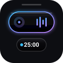

# Dynamic Island Pro for Omarchy

[](LICENSE)
[](https://omarchy.org)
[](https://quickshell.outfoxxed.me)

An Apple-style **Liquid Glass Dynamic Island** positioned at the top-center of your screen for **Omarchy** and **Hyprland**. It reveals seamlessly on hover or stays gracefully alive whenever media is playing, a timer is active, or screen recording is underway.



---

## ✨ Features

### 🏝️ Top-Center Morphing Liquid Glass Island
- **True Physical Physics:** Fluid spring animations (mass, damping, stiffness) that smoothly expand, morph, and contract across states.
- **Smart Reveal & Pinning:** Hover the subtle top-edge sensor to reveal the island instantly, or let it stay dynamically visible when media, timers, or recordings are active. Toggle **Pin Island** to keep it pinned 24/7.
- **Transparent Click-Through Layer:** Input is strictly constrained to the island hit area and sensor; the rest of your screen remains 100% click-through.

### 🎵 High-Fidelity MPRIS Media & Equalizer
- **Dancing 4-Bar Audio Equalizer:** Real-time animated audio visualizer waves that dance smoothly to playback and gently settle on pause.
- **Universal Album Artwork:** Full support for `file://`, absolute local paths, and remote `http(s)://` art URLs (Spotify, Zen Twilight, Chromium, mpv, etc.).
- **Rotating Vinyl Fallback:** Sleek spinning vinyl record animation when album art is unavailable or loading.
- **Seek Scrubber:** Interactive progress line with click-to-seek and duration timestamps.
- **Scroll Volume HUD:** Scroll anywhere over the island capsule to adjust volume, complete with an inline physical volume gauge and percentage readout.
- **Multi-Player Selector:** Automatically tracks active playback, or click chips to lock to a specific player. Right-click the island pill to cycle players on the fly.

### ⏱️ Focus Studio & Persistent Timers
- **Focus & Deep Work Presets:** 1-click presets for **Focus (25m)**, **Deep Work (50m)**, **Short Break (5m)**, and **Long Break (15m)** with custom session labels.
- **Audio Completion Chimes:** Plays a soothing completion chime via `canberra-gtk-play` and sends desktop notifications when sessions end.
- **Splitting Satellite Bubbles:** When a timer or stopwatch is active, the island splits into satellites so both media and timer remain visible side-by-side.
- **Persistent State:** Timer deadline, remaining time, stopwatch, and session counts survive Quickshell restarts and system reboots.

### 🤖 AI Agents & Local Models Hub
- **Status Dashboard:** Live cards and active session indicators for:
  - **Google Antigravity** (CLI & IDE)
  - **Claude Code**
  - **Codex CLI**
  - **Local Models Router** (Bonsai 2 27B / llama-swap / Ollama on port 18080)
- **1-Click Launchers:** Summon terminal sessions or inspect local model endpoints directly from the island panel.

### 🖥️ Hyprland Desk & System Control
- **Workspace Switcher:** Visual workspace occupancy grid with 1-click workspace switching and window counts.
- **Window Switcher:** Real-time list of open windows on the active workspace; click any window to bring it to front and focus.
- **Quick System Actions:**
  - ▧ **Next Wallpaper:** Cycle Omarchy desktop backgrounds (`omarchy theme bg next`).
  - ◐ **Theme Switcher:** Summon Omarchy theme picker (`omarchy theme switcher`).
  - 📸 **Screenshot:** Launch native Wayland screenshot overlay (`omarchy-capture-screenshot`).
  - 📌 **Pin Toggle:** Keep island pinned always or auto-collapse when idle.

---

## 🎮 Gestures & Shortcuts

| Action | Gesture |
|---|---|
| **Open Panel** | Left-Click on main capsule |
| **Play / Pause** | Middle-Click on capsule or hover quick-button |
| **Cycle Players** | Right-Click on capsule |
| **Adjust Volume** | Mouse Wheel Up / Down over capsule |
| **Adjust Timer** | Mouse Wheel Up / Down over timer satellite (±1 min) |
| **Cycle Workspaces** | Mouse Wheel Up / Down over workspace satellite |
| **Quick Focus (25m)**| Left-Click on the expanded `25m` satellite |
| **Dismiss Panel** | Press `Escape` or click outside |

---

## 📦 Installation

To install or update Dynamic Island Pro in your Omarchy shell:

```sh
omarchy plugin add https://github.com/harshithnadig/omarchy-dynamic-island.git --enable
```

To validate the plugin manifest:

```sh
omarchy plugin validate ~/.config/omarchy/plugins/harshith.dynamic-island
```

To remove the plugin:

```sh
omarchy plugin remove harshith.dynamic-island
```

---

## 📋 Requirements

- **Omarchy Quattro** with **Quickshell 0.3.2+**
- Standard system tools: `bash`, `jq`, `playerctl` (optional diagnostic fallback), `canberra-gtk-play` (for timer chimes)
- Hyprland Wayland Compositor

---

## 📄 License

MIT License. Copyright (c) Harshith Nadig. See [LICENSE](LICENSE) for details.
