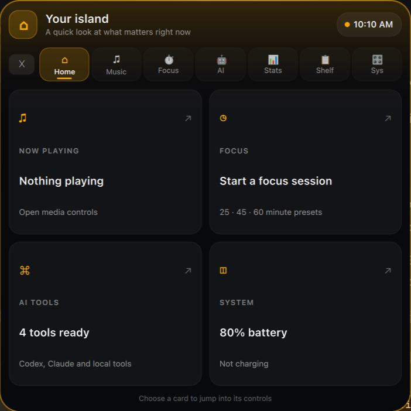

# Dynamic Island Pro for Omarchy

[](LICENSE)
[](https://omarchy.org)
[](https://quickshell.outfoxxed.me)

An original **Liquid Glass Dynamic Island** for **Omarchy** and **Hyprland**. It shows a compact status pill, then opens a command card for media, focus timers, AI tools, system health, and quick controls.

The Home page shows live status cards. Select a card to open its control page.




---

## ✨ Features

### 🏠 Home Overview
- See the current track, focus timer, available AI tools, battery, and audio status at a glance.
- Use the media buttons to skip or play tracks.
- Start or pause a 25-minute focus timer from Home.
- Toggle mute or Night Light from Home.
- Capture a screenshot, toggle Stay Awake, or jump straight to the Clipboard Shelf.
- Select an arrow or AI button to open its control page.
- Open the island to the Home page by default.


### 🏝️ Adaptive Top-Bar Clearance & Fluid Elastic Physics
- **Adaptive Top-Bar Clearance (Auto Detect):** Intelligently inspects the Hyprland layer-shell stack (`hyprctl -j layers`). If an Omarchy top bar, Waybar, or panel is active at $y=0$, the island automatically drops right below it (+3px gap). When no top bar exists, it stays flush against the monitor bezel (0px).
- **Position Presets with State Persistence:** Choose between `Auto (Bar Detect)`, `Flush (0px)`, `Snug (2px)`, and `Float (6px)` right from the Sys tab, persisted automatically across reboots.
- **Press and Hover Feedback:** Eased scale and color transitions respond to pointer input.
- **In-Place Morphing:** The island changes between a 34px pill, a 42px notification banner, and a 520px expanded card.
- **Reduced Motion:** Transitions and alert motion follow Omarchy's reduced-motion setting.
- **Input Masking:** The collapsed island captures input on the pill. The expanded card closes when you click outside it.

### 🤖 AI Agents Studio & Interactive Permission Interceptor
- **Permission Request Interceptor:** Native Quickshell `SocketServer` listening at `$XDG_RUNTIME_DIR/dynamic-island/agents.sock` that intercepts tool `PermissionRequest` events from Claude Code, Codex CLI, and Google Antigravity, popping open an interactive banner with `[ ✓ Allow ]` and `[ ✗ Deny ]` buttons right on the island.
- **Local Models Browser (`llama-swap :18080`, Ollama, vLLM):** Connects to the local model router, displaying installed models (**Ternary Bonsai 2 27B**, **Gemma 4 12B**, **Granite 4.2 8B**, **Qwen 2.5 Coder**) with 1-click terminal chat/test.
- **Quick Prompt Launcher:** Type a prompt directly into the island and launch with your favorite coding agent.

### 📊 Universal Multi-Machine Hardware Telemetry (CPU, RAM, Swap, Multi-Vendor GPU, Net & Disk)
- **Universal Multi-Vendor GPU Support:** Native automatic detection for NVIDIA GPUs (`nvidia-smi`), AMD Radeon GPUs (`/sys/class/drm/card*` VRAM sysfs and hwmon thermals), Intel HD/Iris, and Integrated graphics with fail-open safety.
- **Desktop Workstation Mode:** When running on desktop PCs without battery, the compact resting pill displays real-time network traffic (`↓ 140K`) or online status instead of an unavailable battery icon.
- **Real-Time Network Bandwidth Meter:** Live download and upload throughput calculation directly from `/proc/net/dev` with non-blocking caching.
- **Root Storage Telemetry:** Live gauge of `/` disk space used, total capacity, and percentage with color-coded warning thresholds.
- **Live Performance Telemetry:**
  - **CPU %** with visual load bar
  - **Memory (RAM):** Used / Total GB and percentage with high-memory alert color (>85%)
  - **Swap Memory:** Used / Total GB and percentage
  - **GPU VRAM & Temperature:** Real-time VRAM allocation and thermals (°C)
- **⚡ Memory Optimizer:** 1-click button to flush page caches, drop caches, and sync memory to disk.
- **📦 Arch & Omarchy Updates Monitor:** Read-only update checks via `checkupdates`. Review updates, then run the system updater yourself.

### 🔔 Apple-Grade Notification Peek Banners
- **Live System Peeking:** The island springs open into an elegant notification banner for ~2.6s upon:
  - Track changes (song title, artist, art thumbnail)
  - Charger connected (`⚡ AC Power Connected`) or disconnected (`🔋 Running on Battery`)
  - AI Agent events & permission requests
  - Focus session completion
  - Wallpaper changes & screenshot captures
  - System toggles (WiFi, Bluetooth, Night Light, Caffeine)
- **1-Click Deep Navigation:** Clicking any peek banner morphs directly into that feature's expanded tab.

### 🎵 Real-Time Cava Audio Spectrum & MPRIS Control
- **True PipeWire Cava Visualizer:** 4-bar dancing equalizer tuned to live audio frequency spectrum via Cava, with graceful fallback animation.
- **Bass-Reactive Dynamic Ambient Glow:** Backlight halo pulses organically with audio loudness and kicks on bass drops.
- **Universal Album Artwork & Vinyl Disc:** Smooth artwork loading from local paths, `file://`, and `http(s)://`, with a rotating vinyl record fallback.
- **Interactive Seek Bar & Multi-Player Chips:** Scrubber bar with timestamps, plus quick chips to switch between Spotify, Firefox, MPV, etc.

### 🎛️ Quick Sliders, Radios & System Control
- **Interactive Audio Volume Slider:** Draggable volume slider with mute toggle and exact percentage readout.
- **Interactive Display Brightness Slider:** Draggable brightness slider (0–100%).
- **Quick Radios Controls:** 1-click toggles for 📶 WiFi (`nmcli`) and ᛒ Bluetooth (`bluetoothctl`).
- **Hyprland Workspaces & Windows:** Visual workspace switcher chips and open window list with 1-click focus.
- **Quick Action Bar:**
  - ▧ **Wallpaper:** Cycle background (`omarchy theme bg next`)
  - ◐ **Theme:** Open theme switcher (`omarchy theme switcher`)
  - 📸 **Screenshot:** Wayland screenshot capture (`omarchy screenshot`)
  - 🌙 **Night Light:** Toggle color temperature (`omarchy toggle nightlight`)
  - ☕ **Caffeine:** Stay awake toggle (`omarchy toggle idle`)
  - 🔒 **Lock:** Instant lock session (`loginctl lock-session`)

### 📋 Shelf, Trash Guard & Persistent Scratchpad
- **Trash Guard Cleaner:** Live item counter for `~/.local/share/Trash` with a 1-click `[Empty]` button.
- **Live Clipboard Preview:** Shows a copied text snippet or image preview with "Copy Again" and "Clear" actions. Image previews use a private runtime directory and a 20 MiB size limit.
- **Recent Screenshots Gallery:** Interactive thumbnail strip of the 4 latest screenshots with 1-click open.
- **Auto-Saved Scratchpad:** Persistent multi-line notepad for draft prompts, code snippets, or thoughts that survives shell reboots.

### ⏱️ Focus Studio & Splitting Satellite
- **Focus & Deep Work Presets:** 1-click timers (25m Focus, 50m Deep, 5m Break, 15m Long) with custom session names.
- **Audible Chimes:** Completion chime via `canberra-gtk-play`.
- **Splitting Satellite Bubble:** Shows timer or stopwatch alongside music without cluttering the main pill.

---

## 🎮 Gestures & Shortcuts

| Action | Gesture |
|---|---|
| **Open Card** | Left-Click on resting pill or peek banner |
| **Play / Pause** | Middle-Click on capsule |
| **Cycle Players** | Right-Click on capsule |
| **Volume HUD** | Mouse Wheel Up / Down over capsule |
| **Dismiss Card** | Press `Escape` or click outside the card |

### ⌨️ Terminal & Hyprland Keybindings IPC

Bind in `~/.config/hypr/hyprland.conf`:

```ini
# Toggle Dynamic Island with Super + I
bind = $mainMod, I, exec, ~/.config/omarchy/plugins/harshith.dynamic-island/island-backend.sh toggle
```

Available backend verbs:
- `island-backend.sh toggle`: Toggle expanded command center
- `island-backend.sh expand [home|music|timer|agents|stats|shelf|system]`: Open directly to a tab
- `island-backend.sh collapse`: Close expanded card
- `island-backend.sh peek <icon> <title> [subtitle] [target_tab]`: Trigger dynamic peek banner
- `island-backend.sh empty-trash`: Clean trash instantly
- `island-backend.sh toggle-wifi` / `toggle-bluetooth`: Instant radio switches

---

## 📦 Installation & Verification

To install or update in Omarchy:

```sh
omarchy plugin add https://github.com/harshithnadig/omarchy-dynamic-island.git --enable
```

Validate the plugin:

```sh
omarchy plugin validate ~/.config/omarchy/plugins/harshith.dynamic-island
```

Run test suite:

```sh
~/.config/omarchy/plugins/harshith.dynamic-island/tests/test_backend.sh
```

---

## 📄 License

MIT License. Copyright (c) Harshith Nadig. See [LICENSE](LICENSE) for details.
